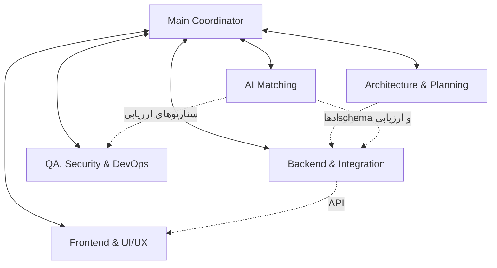

# تیم ایجنت‌های مدیتو

این تیم شامل یک Main Agent و پنج Sub-agent است. فایل‌های نقش در `.codex/agents` قرار دارند؛ هر نقش شامل `name`، `description` و `developer_instructions` است. ساختار فایل‌ها مطابق [مستندات رسمی Subagents](https://learn.chatgpt.com/docs/agent-configuration/subagents) و تنظیمات هم‌زمانی مطابق [مرجع تنظیمات Codex](https://learn.chatgpt.com/docs/config-file/config-reference) است.

## نقش‌ها و مسئولیت‌ها

| نقش | شناسه | مسئولیت | فازهای مرتبط |
| --- | --- | --- | --- |
| Main Coordinator | `medito_main` | تقسیم کار، هماهنگی وابستگی‌ها، تعیین مسئول فایل، حل تعارض، بررسی نهایی و کامیت | همه فازها |
| Architecture & Planning | `architecture_planning` | تحلیل نیاز، معماری، مدل دیتابیس، ساختار پروژه و قراردادهای API | ۱، ۲ و مشورت در همه فازها |
| Frontend & UI/UX | `frontend_ui_ux` | رابط فارسی، تجربه کاربری، صفحات، کامپوننت‌ها، ریسپانسیو و اتصال به API | ۲، ۳، ۴، ۵، ۷، ۸ |
| Backend & Integration | `backend_integration` | منطق تجاری، API، SQL، احراز هویت، رزرو، سیگنالینگ صوتی و اتصال سرویس‌ها | ۳، ۴، ۵، ۷، ۸ |
| QA, Security & DevOps | `qa_security_devops` | تست، امنیت، بازبینی کد، Docker، استقرار و وظایف محول‌شده CI/CD و مانیتورینگ | همه فازها، به‌ویژه ۶ |
| AI Matching | `ai_matching` | تفسیر نیاز، پرامپت و schema مدل، پیشنهاد متکی به دیتابیس، روش جایگزین و ارزیابی AI | هدایت فاز ۸ و مشورت هنگام طراحی |

مدل، سطح استدلال، دسترسی و سیاست تأیید از نشست اصلی به ارث می‌رسند. برای هیچ نقش مدل یا مجوز جداگانه تحمیل نشده است. دستورهای نقش، جایگزین محدودیت‌های محیط نیستند.

## Main و نحوه استفاده

ایجنت اصلی گفت‌وگوی پروژه نقش Main را طبق `AGENTS.md` اجرا می‌کند. فایل `medito_main.toml` تعریف این نقش را نگه می‌دارد؛ ساخت ایجنت هماهنگ‌کننده دوم لازم نیست.

پروژه را با ریشه `medito` در Codex باز کن. برای اجرای CLI از هر پوشه:

```powershell
codex -C 'D:\javascript course\medito'
```

برای بارگذاری تنظیمات و نقش‌های تازه، یک نشست جدید در همین پروژه شروع کن.

در بررسی این دستگاه، Codex اعلام کرد تنظیمات محلی مدیتو هنوز به‌دلیل ثبت‌نبودن اعتماد به پروژه بارگذاری نمی‌شوند. هنگام بازکردن همین پوشه در Codex، اعتماد به پروژه خودت را از رابط Codex تأیید کن و سپس نشست جدید را شروع کن. بازکردن پوشه والد به‌جای `medito` ممکن است تنظیمات این پروژه را انتخاب نکند. فایل تنظیمات سراسری کاربر در این تغییر ویرایش نشده است. تعریف نقش‌ها پس از بارگذاری تنظیمات پروژه در دسترس قرار می‌گیرد.

نمونه درخواست پس از فعال‌سازی:

```text
به‌عنوان Main Agent مدیتو، با تیم تعریف‌شده در AGENTS.md مشکل زیر را حل کن:
[شرح قابلیت یا باگ]
فازهای مرتبط و مسئول هر فایل را مشخص کن، کارهای مستقل را به متخصصان بده،
نتیجه را با QA بررسی کن و تغییر کامل‌شده را کامیت کن.
```

وجود فایل‌ها به‌معنی اجرای دائمی ایجنت‌ها نیست؛ Main برای کار مشخص نقش لازم را فراخوانی می‌کند. اصلاح‌های ساده‌ای که کار مستقل قابل واگذاری ندارند، به راه‌اندازی کل تیم نیاز ندارند. این ایجنت‌ها تیم توسعه پروژه هستند؛ دستیار داخل وب‌اپ در فاز ۸ پیاده‌سازی می‌شود.

## همکاری و ترتیب اجرا



1. Main درخواست جدید را با [فازبندی](../plan.md) تطبیق می‌دهد؛ فازهای تکمیل‌شده خودکار از ابتدا اجرا نمی‌شوند.
2. Architecture تغییر لازم در قرارداد API، مدل داده و وابستگی‌ها را مشخص می‌کند. برای کارهای روشن، Main فقط بخش لازم از این بررسی را محول می‌کند.
3. Main وظیفه محدود و فایل‌های انحصاری هر متخصص را تعیین می‌کند. ابتدا قراردادها توافق می‌شوند؛ سپس کارهای مستقل به‌صورت موازی پیش می‌روند.
4. Backend و AI قرارداد داده و خطا را به Frontend تحویل می‌دهند. Frontend می‌تواند بخش نمایشی مستقل را هم‌زمان پیش ببرد.
5. متخصصان مسئله و پیشنهاد را مستقیم با هم مطرح می‌کنند، اما تغییر قرارداد، انتقال مسئولیت فایل و کار مشترک باید به Main اعلام شود.
6. پس از تثبیت تغییرات، QA تست و بازبینی لازم را انجام می‌دهد. برای تغییرات حساس، بررسی مستقل پیش از کامیت ضروری است.
7. Main یافته‌ها را رفع، نتیجه را یکپارچه و فایل‌های مربوط به قابلیت را جداگانه کامیت می‌کند؛ گزارش نهایی به کاربر را Main ارائه می‌دهد.

تنظیم فعلی حداکثر سه Sub-agent هم‌زمان است؛ با Main چهار جایگاه اشغال می‌شود. پنج تخصص در چند نوبت استفاده می‌شوند. محدودیت کمترِ محیط اولویت دارد. Sub-agentها ایجنت جدیدی نمی‌سازند.

## مسئولیت فایل‌ها

این جدول پیش‌فرض است؛ Main می‌تواند برای هر وظیفه مسئولیت را صریحاً منتقل کند. هر فایل در هر لحظه فقط یک نویسنده دارد.

| مسیر یا بخش | مسئول پیش‌فرض | قاعده همکاری |
| --- | --- | --- |
| `docs/plan.md` و `docs/phases/*` | Architecture | تغییر محدوده با هماهنگی Main |
| صفحات UI در `src/app`، `src/components/*` و `globals.css` | Frontend | مسیر `src/app/api` مستثناست؛ CSS و کامپوننت مشترک هم‌زمان ویرایش نشوند |
| `src/app/api/[...path]/route.ts` | Backend | تمام ایجنت‌ها درخواست تغییر routing را به Backend بدهند |
| `src/lib/*` به‌جز `matching.ts` | Backend | قراردادها با Architecture و مصرف‌کنندگان هماهنگ شوند |
| `src/lib/matching.ts` | AI | این فایل هم منطق مدل و هم handler دارد؛ Backend بازبینی و پیشنهاد می‌دهد یا مسئولیت رسماً منتقل می‌شود |
| `migrations/*` و اسکریپت‌های دیتابیس | Backend | شماره migration با Main هماهنگ شود؛ migration اعمال‌شده بازنویسی نشود |
| `tests/*`، runner و تنظیمات مرورگر | QA | `security.test.ts` داده و ترتیب مشترک دارد؛ AI و Backend سناریوها را به QA تحویل بدهند |
| `Dockerfile`، `compose.yaml` و تنظیمات انتشار | QA | اجرای build، migration و تغییر سرویس فعال با Main هماهنگ شود |
| `package.json`، lockfile، `constants.ts` و `.env.example` | نویسنده تعیین‌شده توسط Main | نصب وابستگی، تغییر قرارداد یا متغیر محیطی موازی انجام نشود |
| `AGENTS.md` و `.codex/*` | Main | نقش‌ها و قواعد همکاری هماهنگ تغییر کنند |

سرویس جدید، پایپ‌لاین CI/CD یا سامانه مانیتورینگ فقط در محدوده وظیفه محول‌شده اضافه می‌شود. مسئولیت DevOps به‌تنهایی مجوز تغییر زیرساخت، داده واقعی یا استقرار تازه نیست.

## تحویل وظیفه و گزارش نتیجه

Main در هر واگذاری این اطلاعات را ارائه می‌کند:

```text
وظیفه و فاز مرتبط:
هدف و معیار پذیرش:
فایل‌های مجاز برای ویرایش:
منابع فقط‌خواندنی و قراردادهای توافق‌شده:
وابستگی‌ها و ایجنت‌های همکار:
بررسی‌ها و تغییرات runtime مجاز:
خروجی مورد انتظار:
```

هر متخصص در پایان این گزارش را به Main تحویل می‌دهد:

```text
نتیجه و تغییر رفتار:
فایل‌های تغییرکرده:
قرارداد یا migration تغییرکرده:
بررسی‌های انجام‌شده و نتیجه واقعی:
ریسک‌ها، وابستگی‌ها و موارد بررسی‌نشده:
کار بعدی و مسئول پیشنهادی:
```

Sub-agentها stage، commit، reset یا stash انجام نمی‌دهند و تغییرات دیگران را برنمی‌گردانند. Main فقط مسیرهای متعلق به وظیفه را وارد کامیت می‌کند. نصب وابستگی، تغییر migration، build، تست دارای fixture مشترک و Docker عملیات مشترک‌اند و هم‌زمان روی یک وضعیت اجرا نمی‌شوند.

## معیارهای کنترل کیفیت

- ترتیب و محدوده هشت فاز، فناوری‌های فعلی و اصل ساده‌بودن معماری حفظ شوند.
- تغییر احراز هویت، مدارک، تأیید متخصص، رزرو، نظر، تماس و پیشنهاد AI با تست حساس مرتبط همراه باشد.
- برای مستندات و تنظیمات ایجنت، اعتبار TOML، مسیرها، نقش‌ها و diff بررسی شود؛ اجرای کامل تست برنامه لازم نیست.
- رضایت ارسال متن، اعتبارسنجی مدل و جست‌وجوی متخصص تأییدشده در فاز ۸ حفظ شوند؛ اطلاعات حساس و کلیدها وارد پیام تیم نشوند.
- پاسخ ساختگی مدل، تست صوتی محلی یا ثبت دستی شواهد، موفقیت اتصال خارجی را اثبات نمی‌کند. محدودیت واقعی در گزارش ثبت شود.

## بررسی این ساختار

- هر هفت فایل TOML با `tomllib` بررسی شده‌اند؛ شش نام نقش یکتا و فیلدهای لازم معتبرند.
- کلیدهای `agents.enabled` و `agents.max_concurrent_threads_per_session` با app-server نسخه نصب‌شده Codex در حالت strict و به‌صورت override موقت بررسی شده‌اند؛ این بررسی تنظیمات سراسری یا اعتماد پروژه را تغییر نداده است.
- تعریف نقش‌ها و مرز فایل‌ها با همکاری دو ایجنت مستقل بازبینی شده‌اند. فایل‌های فازها و منطق وب‌اپ تغییر نکرده‌اند.
- بارگذاری خودکار نقش‌های پروژه تا تأیید اعتماد به پوشه توسط کاربر در Codex، فعال تأیید نشده است. تست کامل وب‌اپ برای این تغییر مستندات و تنظیمات اجرا نشده است.
